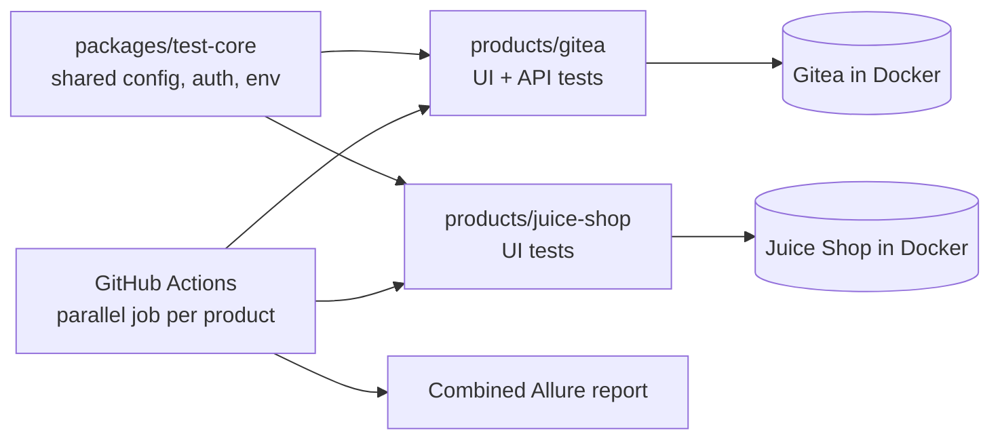

# Automation Platform

Cross-product test automation infrastructure built with **TypeScript** and **Playwright**.
One shared library, many products, one CI pipeline and one combined report.

## Architecture

## Highlights

- **Shared test-core library:** one Playwright configuration for all products, with reusable authentication (storageState) and safe environment handling (`requireEnv`).
- **pnpm monorepo:** a single dependency catalog keeps Playwright on the same version across all products.
- **API Objects and self-cleaning fixtures:** test data is created through the API, verified through the UI, and always cleaned up, even when a test fails.
- **Reliable environment:** `pnpm env:up` starts the products in Docker and waits for health checks before tests run.
- **CI on every pull request:** a parallel job per product, retries with traces on failure, and a combined Allure report.

## How to run

1. Copy `.env.example` to `.env`
2. Install dependencies: `pnpm install`
3. Start the products under test: `pnpm env:up`
4. Run all tests: `pnpm test`
5. Open the combined report: `pnpm report`
6. Stop the products: `pnpm env:down`

## Roadmap

- [x] Shared library, two products, API and UI tests
- [x] CI with parallel jobs, retries, traces and Allure
- [ ] KPI dashboards (Grafana) and flaky-test tracking
- [ ] AI-based failure triage with the Claude API
- [ ] Kubernetes execution and self-service project creation